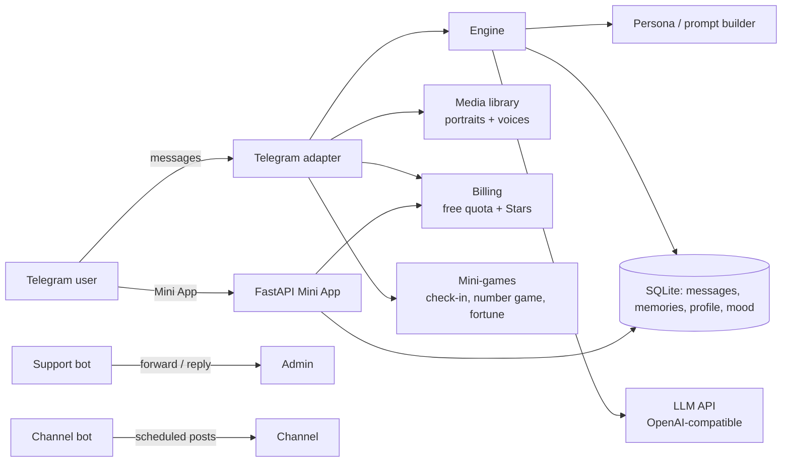
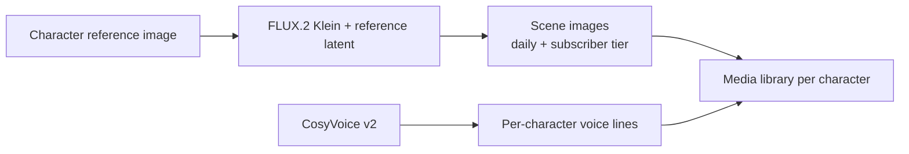

# Velvet — AI Companion Bot for Telegram

An AI companion product built and operated solo: 11 characters, persistent memory, generated portraits and voices, a Telegram Mini App, Stars subscriptions, bilingual UX, moderation, and a separate support bot.

> **Status:** live, early stage. This repo is a **case study** — the production source is private. All images below are AI-generated.


---

## Screenshots

| Mini App (EN) | Character · Lin Wan | Character · Gu Qing |
|---|---|---|
|  |  |  |

---

## What it does

- **11 characters** (8 Chinese, 3 English/Japanese) with distinct ages, cities, speech styles and boundaries
- **Persistent memory**: short-term window + long-term memories (facts, preferences, plans) + a per-user profile (name, city, job, current concerns)
- **Mood & affection**: lightweight state that changes tone over time
- **Voices**: each character has her own TTS voice; bedtime, morning, “miss you”, sleepy and teasing lines
- **Generated portraits**: per-character reference image keeps the same face across scenes
- **Telegram Mini App**: character gallery, plan cards, character switching, Stars checkout
- **Stars subscriptions**: free daily quota → paywall → 30/90-day plans
- **Bilingual by default**: replies follow the user’s language (zh / en / ja); UI, commands, terms and support bot are localized
- **Safety & moderation**: age gate, PII redaction before storage/model, risk-keyword alerts, ban/unban, refund flow for delivery failures
- **Ops automation**: scheduled channel posts, daily ops report, separate support bot

---

## Architecture



**Media pipeline (offline, pre-generated):**



---

## Engineering notes

**Character consistency.** Scene images are generated locally with FLUX.2 Klein, using the character’s portrait as a reference latent (`ReferenceLatent`, chained for multi-reference). Each character keeps her own reference image, scene table, captions, voice folder and subscriber-tier images.

**Memory that survives the chat.** After every N messages the engine asks the model for structured JSON: new memories (kind / text / keywords / importance), profile updates and mood deltas. Memories are deduplicated by token similarity before insertion; the profile is injected into the system prompt on every turn.

**Language follows the user, not the character.** A tiny detector picks zh/en/ja from the incoming message; the system prompt gets a language directive, so an English user talking to a Chinese character gets English back, and vice versa. Command replies, paywall, terms, horoscope and tarot are localized; the support bot does the same.

**Billing without a payment backend.** Telegram Stars invoices are created from plan definitions; successful payments extend a global subscription shared by all characters. Test purchases are tagged so they don’t pollute conversion metrics. Refunds are manual (`refundStarPayment`) and only for delivery failures — that policy is written into the paywall, invoice description and `/terms`.

**Moderation is code, not vibes.** The age gate is enforced before any model call; PII is redacted before writing to the DB; risk keywords trigger an admin alert (not an automatic ban); banned users are blocked before commands are parsed. Content rules live in a single persona module, and the test suite exercises boundary prompts.

**Ops as code.** A channel bot posts on a schedule, a daily report summarizes new users, starts, messages, paywall hits, payments and feature usage, and a separate support bot forwards user messages to the admin with `/reply`, `/lookup` and `/pending`.

---

## Results (honest)

- Built and operated solo: product, prompt/persona design, media pipeline, Mini App, billing, moderation, support bot, ops automation
- Payment flow verified end-to-end with a real Stars purchase (test-tagged)
- Early distribution stage: organic Telegram channel plus paid-channel experiments; no claim of scale yet
- Pricing was raised after unit-economics review (CAC vs. subscription revenue)

---

## Repo layout (production, private)

```
config/souls/        11 character cards (persona, speech, boundaries, backstory)
soulmate/            engine, memory store, persona prompts, billing, media, i18n
soulmate/adapters/   Telegram adapter, CLI, Soul draft adapter
webapp/              FastAPI Mini App (initData verification, roles, invoice)
scripts/             scene/voice generation, asset report, channel posts, daily report
run.py               bot entrypoint
run_support.py       support bot entrypoint
```

---

## Compliance

- **Age-gated.** A verification step before any conversation; product copy states it.
- **AI disclosure.** Characters are AI; users are told the truth if they ask.
- **No minors.** Characters are 22–30; prompts and partner criteria explicitly exclude school/minor themes.
- **No real people.** Characters, images and voices are synthetic.
- **Privacy.** Phone/email/ID/bank numbers are redacted before storage and inference; logs exclude message content.

---

## What I’d build next

1. Referral loop (invite → subscription days) with attribution
2. Better retention instrumentation (D1/D7, message depth, voice usage)
3. Optional IP-Adapter / character LoRA for stronger face consistency
4. English-first funnel and creator partnerships

---

## Contact

Open to AI companion / roleplay bot builds, Telegram Mini Apps, and Stars monetization work.  
GitHub: [@brianwang](https://github.com/brianwang)
